# 🏷️ Portfólio Profissional - João Pedro Silva Dantas 👨‍💻

> [!NOTE]
> Website de portfólio profissional para apresentar minha trajetória, habilidades, projetos, experiências e formas de contato, de maneira moderna, responsiva e acessível.

<table>
  <tr>
    <td width="800px">
      <div align="justify">
        Este projeto é o <b>Laboratório 01</b> da disciplina de <b>Desenvolvimento e Integração de Aplicações Web (DIAW)</b>, do curso de Engenharia de Software da PUC Minas. O site é uma página única com quatro abas (<i>Sobre mim</i>, <i>Projetos</i>, <i>Experiências</i> e <i>Contato</i>) e foi construído com <b>Vite</b>, HTML, CSS e JavaScript. O desenvolvimento acontece em três sprints: planejamento e protótipo, funcionalidades principais, e hospedagem com finalização.
      </div>
    </td>
    <td>
      <div>
        
      </div>
    </td>
  </tr>
</table>

---

## 🚧 Status do Projeto

[](https://joaodantasportfolio.vercel.app/)


| Sprint | Entrega | Status |
| :--- | :--- | :---: |
| **Lab01S01** | Planejamento, wireframes, protótipo inicial, navegação e layout base | ✅ Entregue |
| **Lab01S02** | Funcionalidades principais (idioma PT/EN, timeline dinâmica, formulário, validações) | ✅ Entregue |
| **Lab01S03** | Hospedagem na nuvem, ajustes finais e README final | ✅ Entregue |

---

## 📚 Índice
- [Links Úteis](#-links-úteis)
- [Sobre o Projeto](#-sobre-o-projeto)
- [Funcionalidades Principais](#-funcionalidades-principais)
- [Instruções de Uso](#-instruções-de-uso)
- [Tecnologias Utilizadas](#-tecnologias-utilizadas)
- [Arquitetura](#-arquitetura)
- [Protótipos (Wireframes)](#-protótipos-wireframes)
- [Instalação e Execução](#-instalação-e-execução)
  - [Pré-requisitos](#pré-requisitos)
  - [Variáveis de Ambiente](#-variáveis-de-ambiente)
  - [Instalação de Dependências](#-instalação-de-dependências)
  - [Como Executar a Aplicação](#-como-executar-a-aplicação)
- [Deploy](#-deploy)
- [Estrutura de Pastas](#-estrutura-de-pastas)
- [Demonstração](#-demonstração)
- [Documentações utilizadas](#-documentações-utilizadas)
- [Autores](#-autores)
- [Agradecimentos](#-agradecimentos)

---

## 🔗 Links Úteis
* 🌐 **Demo Online:** [joaodantasportfolio.vercel.app](https://joaodantasportfolio.vercel.app/)
  > 💻 **Descrição:** Site publicado gratuitamente na nuvem (Vercel).
* 🎨 **Protótipos:** [Wireframes em PDF](docs/wireframe.pdf)
  > 🖌️ **Descrição:** Wireframes de média fidelidade das quatro telas, feitos no Figma.
* 💻 **Código:** [Repositório no GitHub](https://github.com/joaodantas-eng/portfolio)

---

## 📝 Sobre o Projeto

**Por que ele existe:** um portfólio é o cartão de visita de quem está começando na área de tecnologia. Este site reúne em um só lugar quem eu sou, o que já construí e como me encontrar.

**Qual problema resolve:** recrutadores e colegas precisam entender rápido a trajetória, as habilidades e os projetos de uma pessoa. Em vez de links soltos, o site organiza tudo em quatro abas simples, com uma linha do tempo que mostra a evolução dos projetos.

**Contexto:** acadêmico (Laboratório 01 de DIAW, PUC Minas) e profissional (porta de entrada para oportunidades na área de tecnologia).

**Onde pode ser usado:** em candidaturas a vagas, no LinkedIn, no GitHub e em apresentações.

> [!NOTE]
> Este projeto foi desenvolvido com auxílio de inteligência artificial (Claude), conforme autorização do professor da disciplina.

---

## ✨ Funcionalidades Principais

- 🧭 **Navegação por abas, sem recarregar:** o menu troca o conteúdo na mesma página, então o cabeçalho e as animações não reiniciam. Cada aba tem seu endereço (`#sobre`, `#projetos`, `#experiencias`, `#contato`), e o botão "voltar" do navegador funciona.
- 💊 **Botões em pílula:** no hover, uma seta aparece num círculo à direita. A aba atual fica em laranja.
- 🌙 **Tema claro e escuro:** botão no canto superior direito. O novo tema aparece num círculo que cresce a partir do botão, e a escolha fica salva.
- 🔗 **Links animados:** um fundo azul entra da esquerda e o link fica branco, com uma seta deslizando.
- 🃏 **Cards que "afundam":** as imagens dos cards inclinam e afundam sob o cursor, com sombra e brilho que acompanham o ponteiro.
- 👤 **Sobre mim:** apresentação, formação (Engenharia de Software na PUC Minas, início em 2026, 2º período, conclusão prevista em 2029), idiomas, as tecnologias que uso e um botão para **baixar o currículo em PDF**.
- 🕒 **Linha do tempo de projetos:** do mais antigo ao mais recente, com imagem, descrição, tecnologias e links (código, site ou demo). Clicar no print abre um **GIF do projeto em funcionamento**.
- 💼 **Experiências:** graduação, evento técnico (We Make Software), experiências profissionais, trabalhos como designer e sites que desenvolvi.
- 📨 **Contato:** ícones clicáveis (GitHub, e-mail, WhatsApp, LinkedIn e Instagram) e formulário.
- ✏️ **Detalhes "escritos a giz":** a fonte Chalk aparece em pequenas anotações (saudação, datas da linha do tempo e notas ao lado dos títulos).
- 📱 **Design responsivo:** usa a largura toda da tela no desktop e se adapta a tablet e celular.

**Funcionalidades da Sprint 2:**

- 🌐 **Português e inglês:** o botão PT/EN traduz o site inteiro na hora, sem recarregar, e a escolha fica salva. Os textos ficam em `src/data/textos.json`.
- 🕒 **Timeline dinâmica:** os projetos ficam em `src/data/projetos.json`. O JavaScript ordena por data e monta os cards; para adicionar um projeto, basta incluir um item no arquivo. As experiências seguem a mesma ideia (`src/data/experiencias.json`).
- ✉️ **Formulário funcional:** a mensagem chega no meu e-mail pelo **EmailJS**.
- ✅ **Validações:** nome com pelo menos 2 letras, e-mail em formato válido e mensagem com pelo menos 10 caracteres. Os erros aparecem embaixo de cada campo, no idioma escolhido, e somem conforme a pessoa corrige.

**Ajustes da Sprint 3:**

- 🔗 **Prévia do link:** ao compartilhar o site no WhatsApp, LinkedIn ou Discord, aparece um card com título, descrição e imagem (tags Open Graph).
- ♿ **Acessibilidade revisada:** auditoria com o [axe-core](https://github.com/dequelabs/axe-core) (a mesma base do Lighthouse) nas quatro abas, nos dois temas e nos dois idiomas, sem nenhum problema restante. Foram corrigidos contraste, a estrutura da lista de informações e o nome do botão de idioma.
- 🤖 **Anti-spam no formulário:** um campo escondido, que só robôs preenchem, bloqueia o envio automático sem precisar de captcha.
- ⚡ **Carregamento mais leve:** os ícones e imagens das abas fechadas só carregam quando a aba é aberta.
- 🎞️ **Projetos em funcionamento:** cada projeto tem um GIF de cerca de 6 segundos, gravado da tela e acelerado. Os cards mostram o print parado, e o GIF (1 a 2 MB) só é baixado quando a pessoa clica. Quem desativou animações no sistema vê o print em vez do GIF.

---

## 📖 Instruções de Uso

1. Acesse **[joaodantasportfolio.vercel.app](https://joaodantasportfolio.vercel.app/)**.
2. Use o **menu azul** para trocar entre *Sobre mim*, *Projetos*, *Experiências* e *Contato*. A página não recarrega, e o botão "voltar" do navegador funciona. Dá para mandar o link direto de uma aba, como [`/#projetos`](https://joaodantasportfolio.vercel.app/#projetos).
3. No canto superior direito:
   * **◐** troca entre tema claro e escuro;
   * **EN / PT** troca o idioma do site.

   As duas escolhas ficam salvas para a próxima visita.
4. Em **Sobre mim**, o botão laranja baixa o **currículo em PDF**.
5. Em **Projetos**, passe o mouse sobre um print para ver o efeito de inclinação e **clique nele para ver o projeto em ação** (um GIF curto). Ele fecha no ✕, no Esc ou clicando fora.
6. Em **Contato**, clique num ícone para falar direto por GitHub, e-mail, WhatsApp, LinkedIn ou Instagram, ou preencha o **formulário**. A mensagem chega direto no meu e-mail.

---

## 🛠 Tecnologias Utilizadas

### 💻 Front-end

* **Build Tool:** [Vite](https://vite.dev/) 8.x (servidor de desenvolvimento e build)
* **Linguagens:** HTML5, CSS3 e JavaScript (módulos ES)
* **Estilização:** CSS puro, com Grid, Flexbox, variáveis CSS, gradientes e media queries
* **Animação da troca de tema:** [View Transitions API](https://developer.mozilla.org/pt-BR/docs/Web/API/View_Transition_API) do navegador
* **Envio de e-mail:** [EmailJS](https://www.emailjs.com/) (`@emailjs/browser`)
* **Fontes:** [Fontsource](https://fontsource.org/) (Unbounded nos títulos e Plus Jakarta Sans no texto), instaladas via npm, e **Chalk** (arquivo próprio, em `src/assets/fonts`) nos detalhes
* **Ícones das tecnologias:** [Devicon](https://devicon.dev/) e [Simple Icons](https://simpleicons.org/), salvos no próprio projeto

### 📦 Dependências (npm)

| Pacote | Tipo | Para que serve |
| :--- | :--- | :--- |
| `vite` | desenvolvimento | Servidor local e build do site |
| `@emailjs/browser` | produção | Enviar o formulário de contato por e-mail |
| `@fontsource/unbounded` | produção | Fonte dos títulos |
| `@fontsource/plus-jakarta-sans` | produção | Fonte dos textos |

### 🖥️ Back-end

* Não há back-end próprio. O formulário envia as mensagens pelo **EmailJS**, direto do front-end.

### 🎨 Design

* **Protótipos:** Figma

### ⚙️ Infraestrutura & DevOps

* **Versionamento:** Git e GitHub
* **Hospedagem:** [Vercel](https://joaodantasportfolio.vercel.app/)

---

## 🏗 Arquitetura

O site é uma **página única estática**, construída com Vite:

- **Um só `index.html`** com o cabeçalho, a barra de navegação, o rodapé e as quatro seções (abas). Só uma aba aparece por vez.
- **Troca de abas por endereço (`#`):** os botões do menu apontam para `#sobre`, `#projetos` etc. O `src/js/abas.js` escuta a mudança do endereço e guarda a aba aberta em `<html data-aba="...">`; o CSS mostra só a seção correspondente. Um script curto no `<head>` faz a mesma escolha antes de a página aparecer, para nada piscar.
- **Dados separados do código:** textos, projetos e experiências ficam em arquivos JSON na pasta `src/data`, em português e inglês.
- **Um único ponto de entrada** (`src/main.js`), que importa as fontes, o CSS e os scripts:
  - `src/js/idioma.js`: troca português/inglês e avisa os outros scripts quando o idioma muda;
  - `src/js/projetos.js` e `src/js/experiencias.js`: montam os cards a partir dos JSON;
  - `src/js/formulario.js`: valida e envia o formulário pelo EmailJS;
  - `src/js/abas.js`: troca de abas sem recarregar a página;
  - `src/js/ampliar.js`: abre o print do projeto em tamanho grande;
  - `src/js/link.js`: cria os links animados;
  - `src/js/tema.js`: botão de tema claro/escuro (salva a escolha no `localStorage`);
  - `src/js/tilt.js`: efeito de inclinação dos cards, com uma "mola" que dá peso ao movimento.
- **Tema escuro com variáveis CSS:** as cores ficam em `:root` e são trocadas em `[data-theme="dark"]`. O mesmo script do `<head>` aplica o tema salvo antes de a página aparecer.
- **Um único arquivo de estilos** (`src/styles/style.css`), com as cores e fontes definidas em variáveis CSS (`:root`), o que facilita manter a identidade visual.
- **Arquivos estáticos** (fotos, prints dos projetos e ícones) na pasta `public/`.

**Decisões:**
- **Vite** foi escolhido por ser exigência do laboratório e por oferecer servidor local rápido e build otimizado.
- **Página única com abas**, em vez de páginas separadas: ao trocar de seção, o cabeçalho, o menu e as animações continuam no lugar, e o conteúdo novo entra com uma transição curta. A divisão em quatro seções do wireframe foi mantida.

**Paleta:** fundo branco, azul (`#0f2d6b` → `#3b82f6`) como cor secundária e laranja (`#ea580c` → `#fbbf24`) nos detalhes, sempre em gradientes: aba ativa no menu, linha do tempo, títulos e projeto em andamento.

As cores foram inspiradas no meu teclado: o azul e o laranja das teclas viraram a identidade visual do portfólio. ⌨️

<div align="center">
  
</div>

---

## 🎨 Protótipos (Wireframes)

Wireframes de média fidelidade feitos no Figma. O arquivo completo está em [`docs/wireframe.pdf`](docs/wireframe.pdf).

| Sobre mim | Projetos |
| :---: | :---: |
| 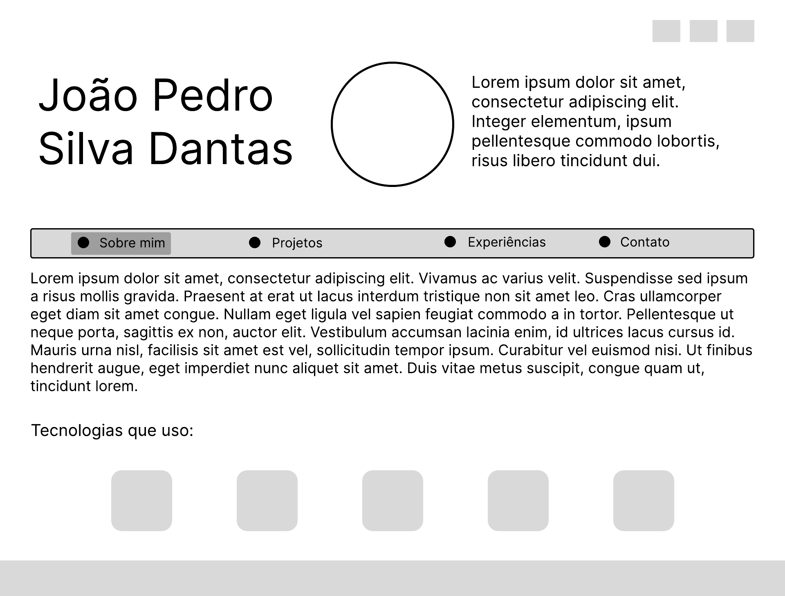 | 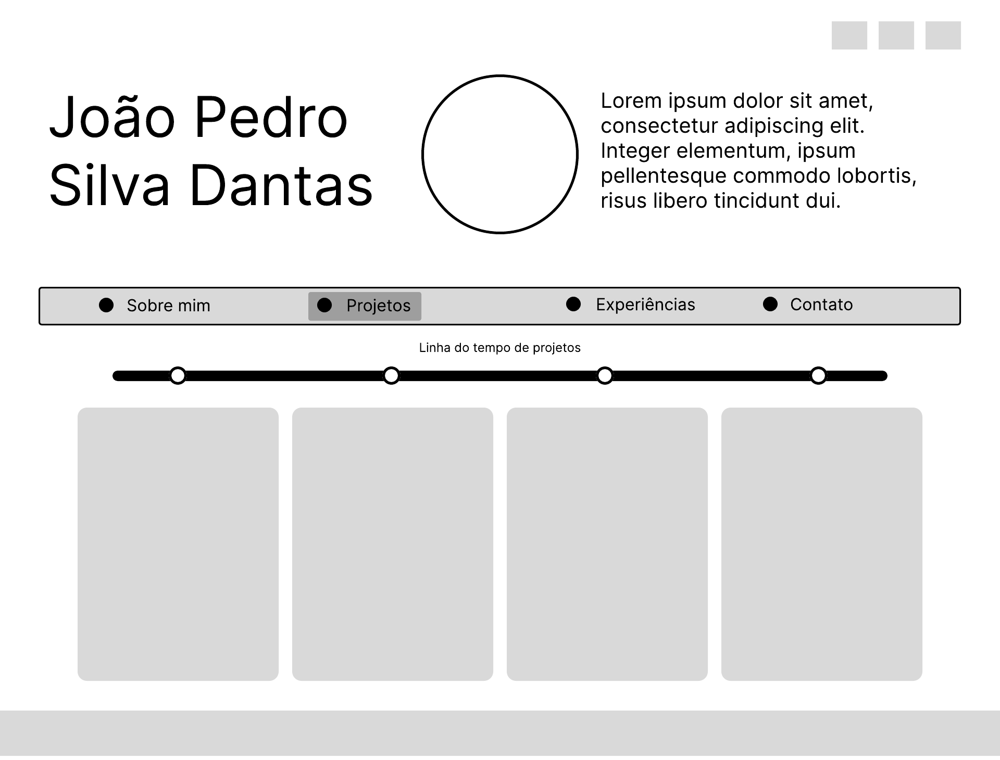 |
| **Experiências** | **Contato** |
| 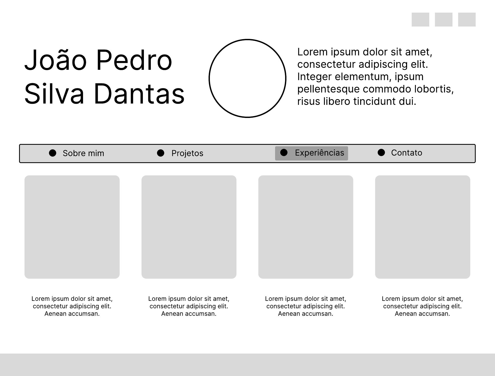 | 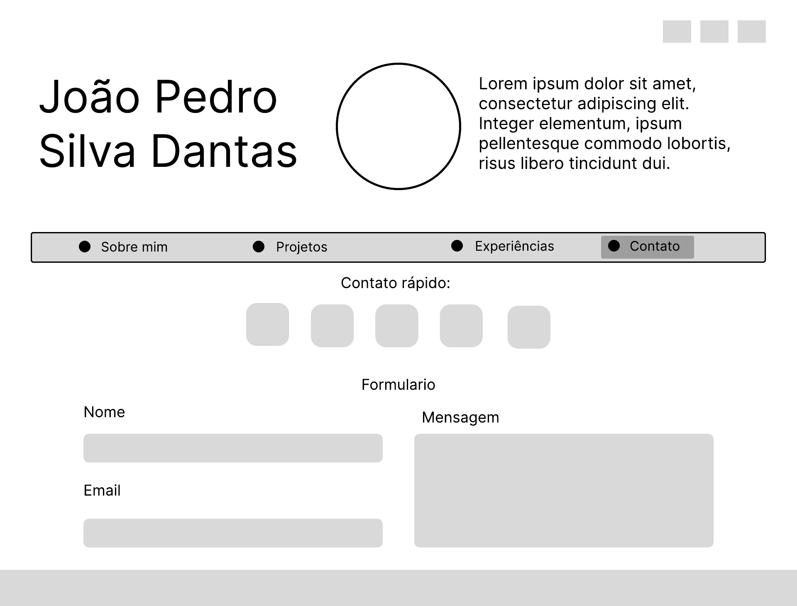 |

Todas as páginas compartilham o mesmo cabeçalho (nome, foto, resumo e botões no canto superior direito) e a barra de navegação com as quatro seções.

---

## 🔧 Instalação e Execução

### Pré-requisitos

* **Node.js:** versão **20.19** ou superior (ou **22.12** ou superior), exigência do Vite 8
* **Gerenciador de pacotes:** npm (já vem com o Node.js)
* **Git**

---

### 🔑 Variáveis de Ambiente

O envio do formulário usa três chaves do EmailJS. Elas ficam no arquivo **`.env.local`**, na raiz do projeto, que **não vai para o GitHub** (está no `.gitignore`). O arquivo `.env.example` mostra o formato:

| Variável | Descrição | Exemplo |
| :--- | :--- | :--- |
| `VITE_EMAILJS_SERVICE_ID` | ID do serviço de e-mail conectado no EmailJS | `service_xxxxxxx` |
| `VITE_EMAILJS_TEMPLATE_ID` | ID do template da mensagem | `template_xxxxxxx` |
| `VITE_EMAILJS_PUBLIC_KEY` | Chave pública da conta do EmailJS | `xxxxxxxxxxxxxxxxx` |

Para rodar localmente, copie o `.env.example` para `.env.local` e preencha:

```bash
cp .env.example .env.local
```

> [!NOTE]
> As variáveis começam com `VITE_` porque o Vite só deixa o código do navegador ler variáveis com esse prefixo. A chave do EmailJS é pública (feita para ficar no front-end); para mais segurança, no painel do EmailJS dá para permitir envios apenas a partir do domínio do site.

**Na Vercel:** as mesmas três variáveis estão cadastradas em *Project Settings → Environment Variables*. Se mudar alguma, faça um *Redeploy*, porque o Vite coloca os valores no site na hora do build.

---

### 📦 Instalação de Dependências

1.  **Clone o repositório:**

```bash
git clone https://github.com/joaodantas-eng/portfolio.git
cd portfolio
```

2.  **Instale as dependências:**

```bash
npm install
```

---

### ⚡ Como Executar a Aplicação

**Modo de desenvolvimento** (atualiza a página sozinho a cada mudança no código):

```bash
npm run dev
```
🎨 *O site estará disponível em **http://localhost:5173**.*

**Gerar a versão de produção** (cria a pasta `dist/`):

```bash
npm run build
```

**Testar a versão de produção localmente:**

```bash
npm run preview
```
🚀 *O site estará disponível em **http://localhost:4173**.*

---

## 🚀 Deploy

O site está publicado na **Vercel**: **[joaodantasportfolio.vercel.app](https://joaodantasportfolio.vercel.app/)**

A cada `git push` na branch `main`, a Vercel faz um novo deploy sozinha. Para publicar uma cópia do projeto:

1.  Entre em [vercel.com](https://vercel.com/) com a conta do GitHub.
2.  Clique em **Add New → Project** e escolha este repositório.
3.  A Vercel reconhece o Vite sozinha. Confira estas configurações:
    * **Framework Preset:** Vite
    * **Build Command:** `npm run build`
    * **Output Directory:** `dist`
4.  Em **Environment Variables**, cadastre as três variáveis do EmailJS (veja [Variáveis de Ambiente](#-variáveis-de-ambiente)). Sem elas, o formulário não envia.
5.  Clique em **Deploy**. A cada `git push` na branch `main`, uma nova versão é publicada.

---

## 📂 Estrutura de Pastas

```
.
├── .gitignore                   # 🧹 Ignora node_modules, dist e .env.local.
├── .env.example                 # 🧩 Modelo das variáveis do EmailJS.
├── .env.local                   # 🔒 Chaves do EmailJS (não versionado).
├── README.md                    # 📘 Documentação principal do projeto.
├── package.json                 # 📦 Dependências e scripts (dev, build, preview).
├── package-lock.json            # 🔒 Versões exatas das dependências.
│
├── index.html                   # 🏠 Página única: cabeçalho, menu, as 4 abas e rodapé.
│
├── /src                         # 📂 Código-fonte
│   ├── main.js                  # 🚪 Ponto de entrada (importa fontes, estilos e scripts).
│   ├── /js
│   │   ├── abas.js              # 🗂️ Troca de abas sem recarregar.
│   │   ├── ampliar.js           # 🔍 Abre o print do projeto em tamanho grande.
│   │   ├── experiencias.js      # 💼 Monta os cards de experiência.
│   │   ├── formulario.js        # ✉️ Validação e envio do formulário (EmailJS).
│   │   ├── idioma.js            # 🌐 Português / inglês.
│   │   ├── link.js              # 🔗 Links animados.
│   │   ├── projetos.js          # 🕒 Monta a linha do tempo.
│   │   ├── tema.js              # 🌙 Botão de tema claro/escuro.
│   │   └── tilt.js              # 🃏 Efeito de inclinação dos cards.
│   ├── /data
│   │   ├── textos.json          # 🌐 Textos do site em PT e EN.
│   │   ├── projetos.json        # 🕒 Projetos da linha do tempo.
│   │   └── experiencias.json    # 💼 Experiências.
│   ├── /assets
│   │   └── /fonts
│   │       └── chalk.woff2      # ✏️ Fonte Chalk (detalhes escritos a giz).
│   └── /styles
│       └── style.css            # 🎨 Cores, temas, componentes e responsividade.
│
├── /public                      # 🖼️ Arquivos estáticos, copiados sem alteração.
│   ├── /curriculo               # 📄 Currículo em PDF (botão "Baixar meu currículo").
│   └── /img
│       ├── logo.svg             # 🏷️ Logo do projeto e favicon.
│       ├── compartilhar.jpg     # 🔗 Imagem da prévia do link.
│       ├── foto.webp            # 👤 Foto de perfil.
│       ├── /projetos            # 🕒 Prints dos projetos (/grande: tamanho original; /gif: projetos em funcionamento).
│       ├── /tech                # 🧰 Logos das tecnologias.
│       └── /contato             # 📨 Ícones de contato.
│
└── /docs                        # 📚 Documentação
    ├── wireframe.pdf            # 🎨 Wireframes completos (Figma).
    ├── wireframe-*.png          # 🎨 Wireframes de cada página.
    └── /prints                  # 📸 Capturas do site funcionando.
```

---

## 🎥 Demonstração

Capturas do protótipo funcionando.

### 🌐 Aplicação Web (desktop)

| Aba | Captura de Tela |
| :---: | :---: |
| **Sobre mim** | **Projetos** |
| 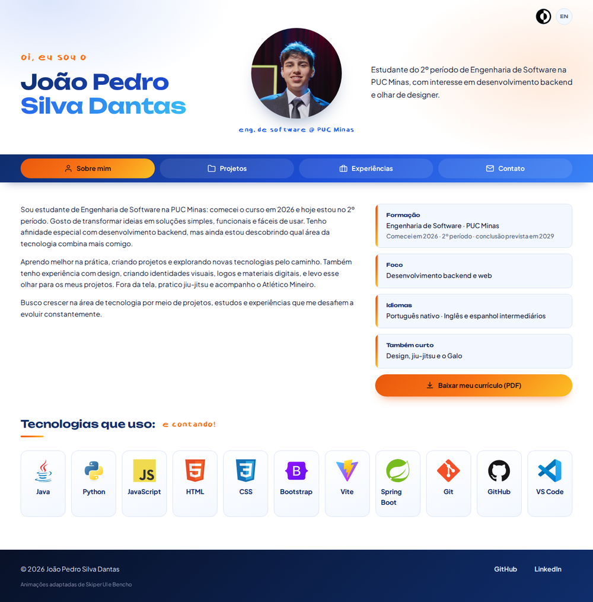 | 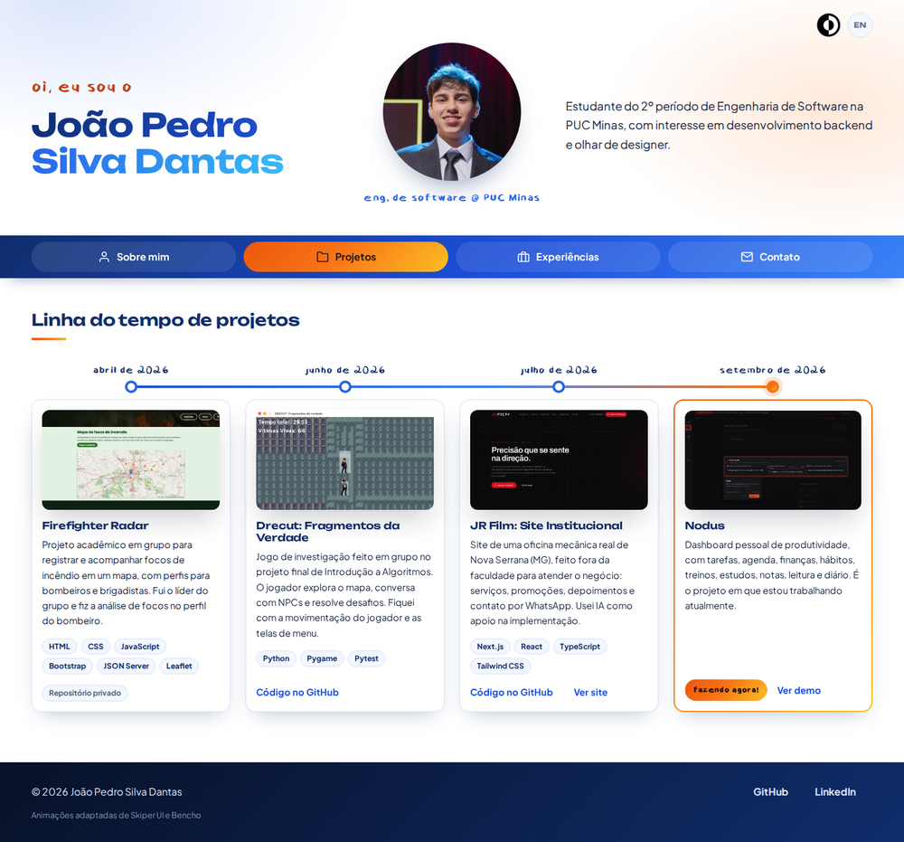 |
| **Experiências** | **Contato** |
| 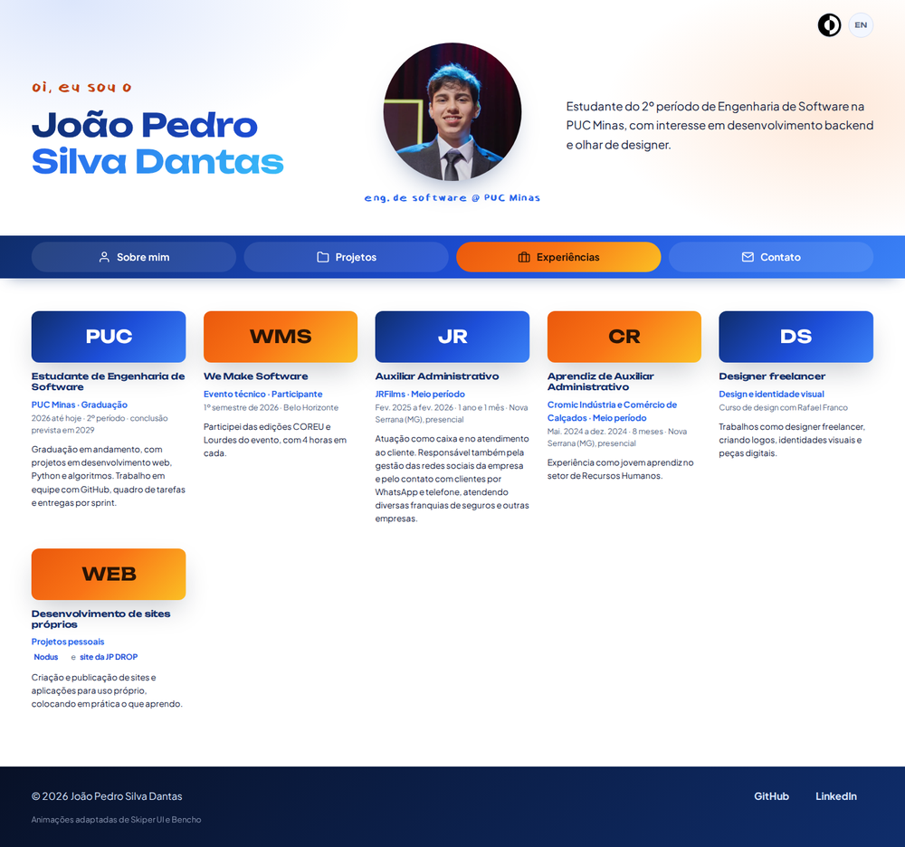 | 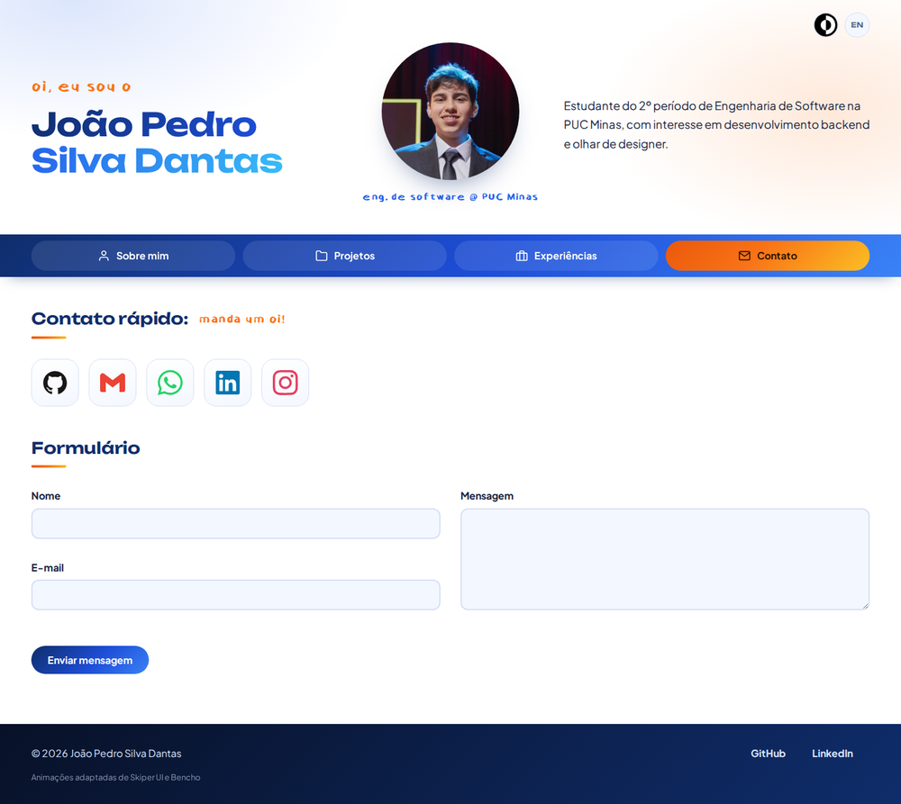 |

### 🎞️ Projetos em funcionamento

| Firefighter Radar | Drecut: Fragmentos da Verdade |
| :---: | :---: |
| 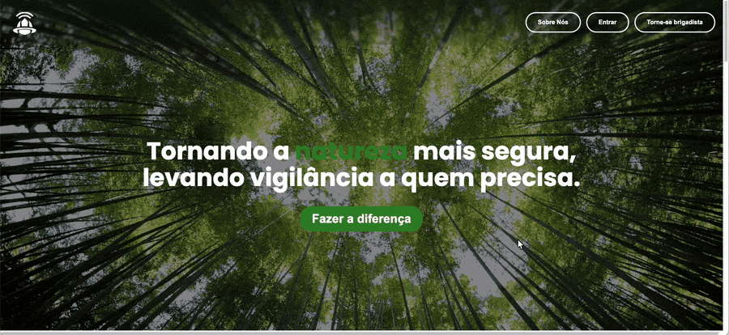 | 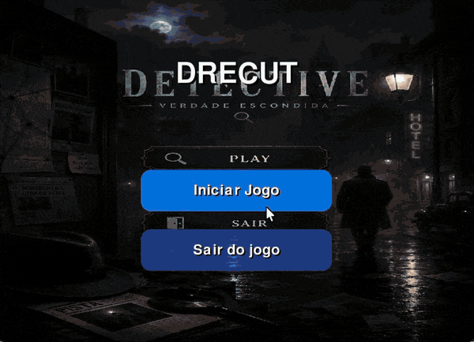 |
| **JR Film: Site Institucional** | **Nodus** |
| 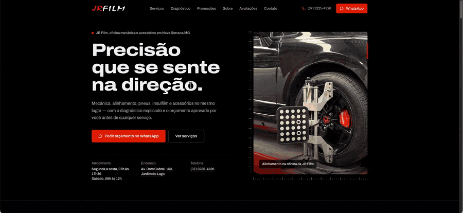 | 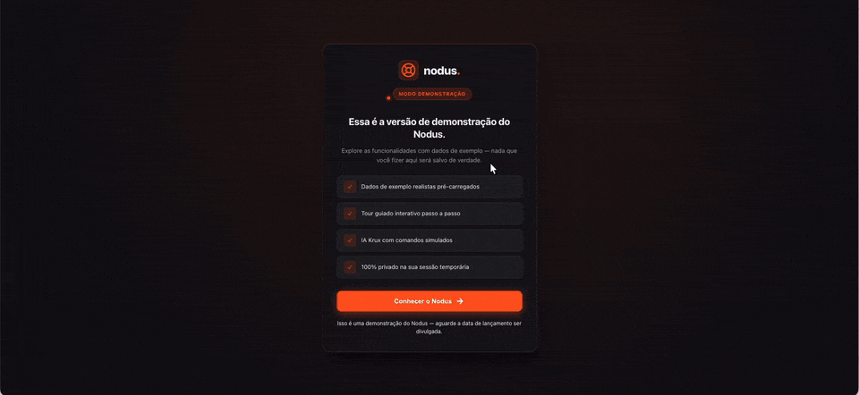 |

### 🌐 Em inglês

| Sobre mim | Projetos |
| :---: | :---: |
| 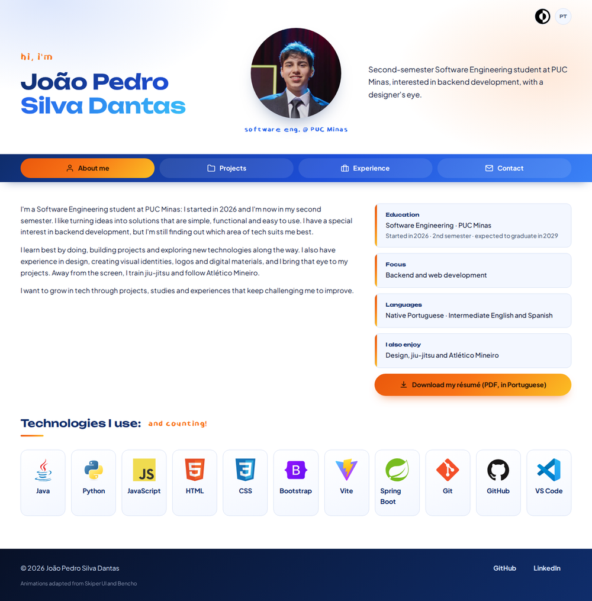 |  |

### 🌙 Tema escuro

| Sobre mim | Projetos |
| :---: | :---: |
| 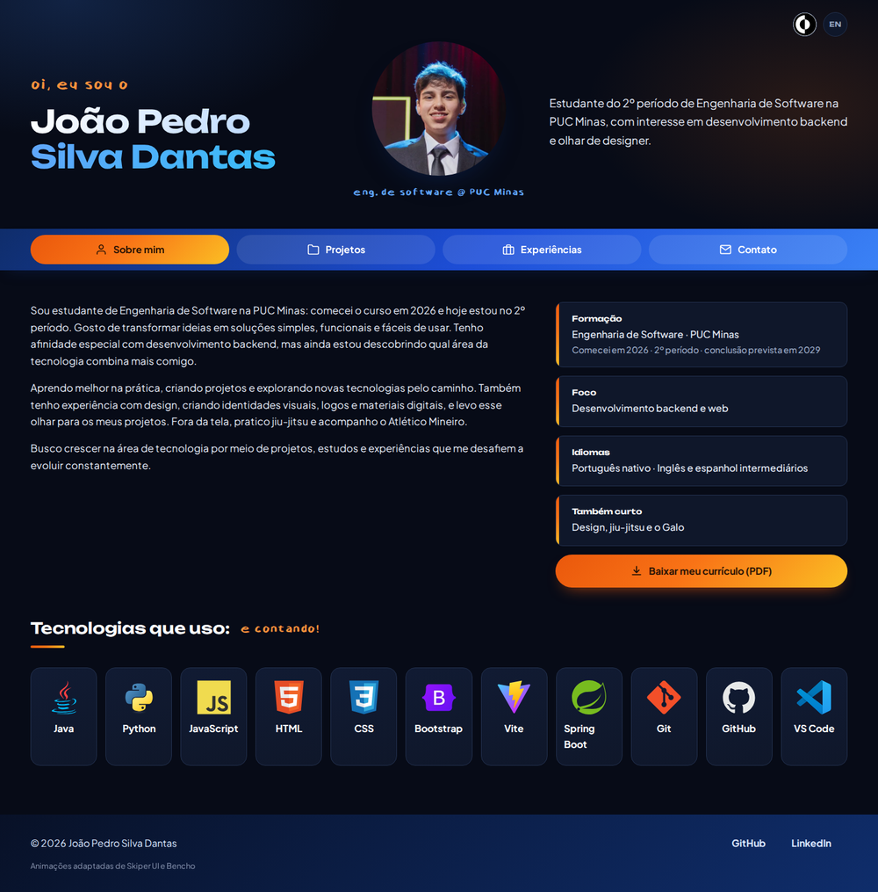 | 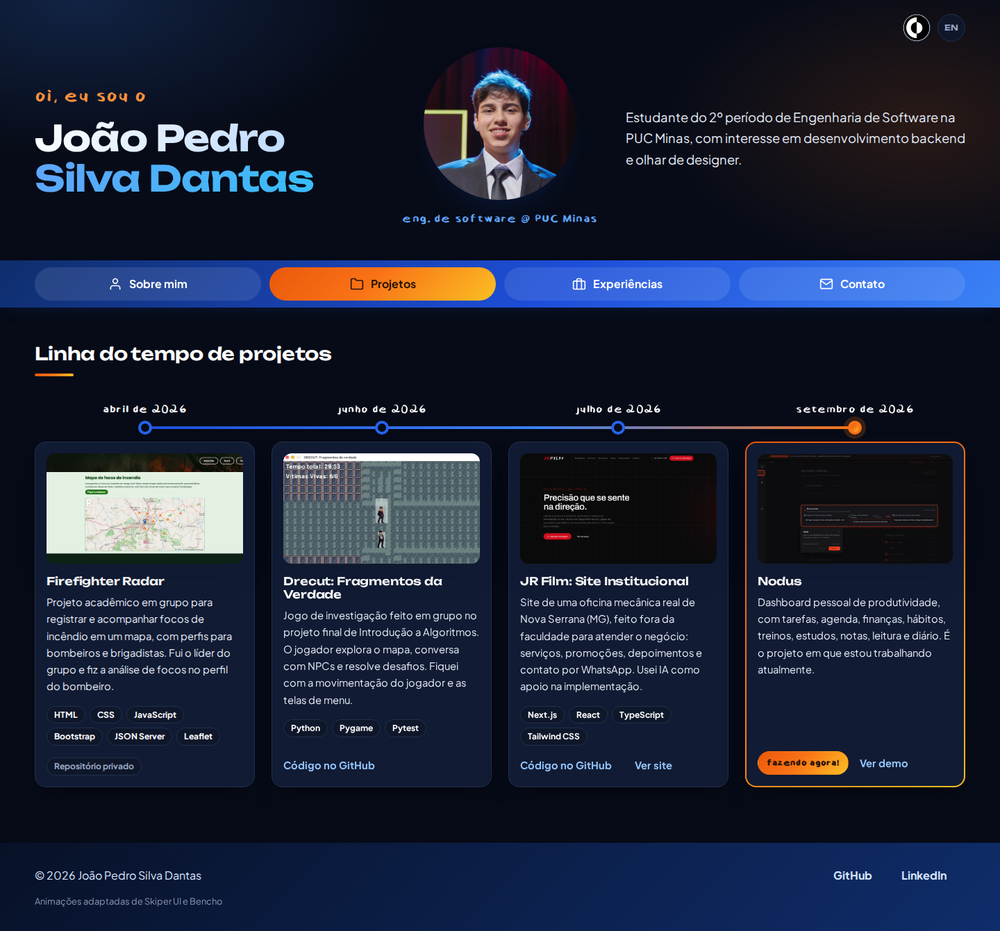 |

### 📱 Aplicação Web (celular)

| Sobre mim | Projetos | Experiências | Contato |
| :---: | :---: | :---: | :---: |
| 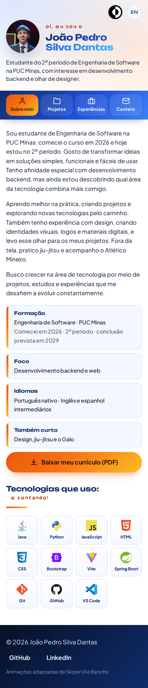 | 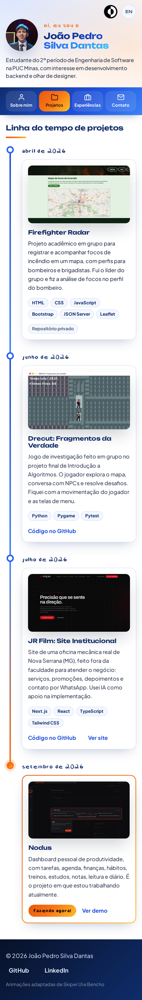 | 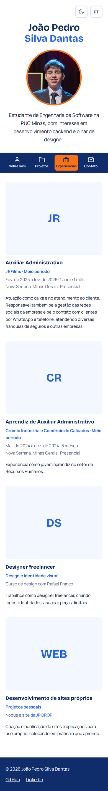 | 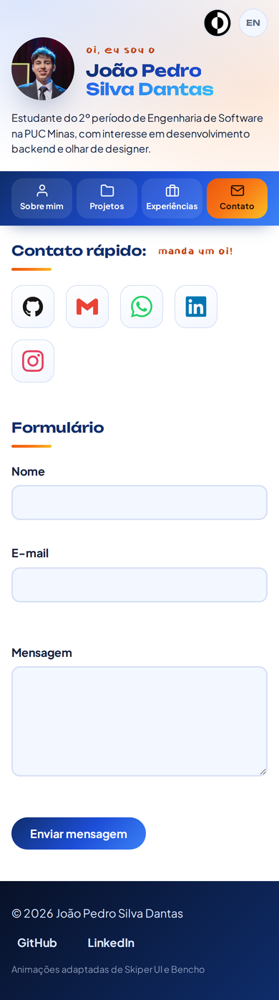 |

---

## 🔗 Documentações utilizadas

* 📖 **Build Tool:** [Documentação oficial do **Vite**](https://vite.dev/guide/)
* 📖 **Fontes:** [Fontsource](https://fontsource.org/docs/getting-started/install)
* 📖 **Ícones:** [Devicon](https://devicon.dev/) e [Simple Icons](https://simpleicons.org/)
* 📖 **Troca de tema:** [MDN - View Transition API](https://developer.mozilla.org/pt-BR/docs/Web/API/View_Transition_API)
* 📖 **Formulário:** [Documentação do EmailJS](https://www.emailjs.com/docs/sdk/send/)
* 📖 **Variáveis no Vite:** [Env Variables and Modes](https://vite.dev/guide/env-and-mode)
* 📖 **Troca de abas:** [MDN - evento hashchange](https://developer.mozilla.org/pt-BR/docs/Web/API/Window/hashchange_event)
* 📖 **CSS:** [MDN - CSS Grid Layout](https://developer.mozilla.org/pt-BR/docs/Web/CSS/CSS_grid_layout) e [MDN - Flexbox](https://developer.mozilla.org/pt-BR/docs/Web/CSS/CSS_flexible_box_layout)
* 📖 **Hospedagem:** [Documentação da **Vercel** para Vite](https://vercel.com/docs/frameworks/vite)

---

## 👥 Autores

| 👤 Nome | 🖼️ Foto | :octocat: GitHub | 💼 LinkedIn | 📤 Gmail |
|---------|----------|-----------------|-------------|-----------|
| João Pedro Silva Dantas | <div align="center"></div> | <div align="center"><a href="https://github.com/joaodantas-eng"></a></div> | <div align="center"><a href="https://www.linkedin.com/in/joaopedrosdantas/"></a></div> | <div align="center"><a href="mailto:joaopedrosilvadantas3@gmail.com"></a></div> |

---

## 🙏 Agradecimentos

* [**Engenharia de Software PUC Minas**](https://www.instagram.com/engsoftwarepucminas/) - Pelo apoio institucional e pela estrutura acadêmica.
* [**Prof. Dr. João Paulo Aramuni**](https://github.com/joaopauloaramuni) - Pela proposta do laboratório e pelo template de README.

### 🧩 Créditos dos componentes

Componentes adaptados para JavaScript puro (os originais são em React):

| Componente | Onde uso | Fonte |
| :--- | :--- | :--- |
| **Skiper 26** (botão de tema, variante *circle*) | Botão de tema claro/escuro | [skiper-ui.com/v1/skiper26](https://skiper-ui.com/v1/skiper26) |
| **Skiper 40** (link animado 5) | Links dos projetos, das experiências e do rodapé | [skiper-ui.com/v1/skiper40](https://skiper-ui.com/v1/skiper40) |
| **Button 02** (pílula com seta) | Botões do menu das abas | [details.so/vault/button-02](https://www.details.so/vault/button-02) |
| **Tilt card** | Imagens dos projetos e das experiências | [bencho.dev](https://bencho.dev/saved?c=tilt&theme=light) · licença MIT ([bencho.dev/licence](https://bencho.dev/licence)) |

Os componentes do Skiper UI são de uso livre, com atribuição ao Skiper UI (por isso o crédito também aparece no rodapé do site). O botão de tema se baseia no conceito de [rudrodip](https://github.com/rudrodip/theme-toggle-effect).

---
